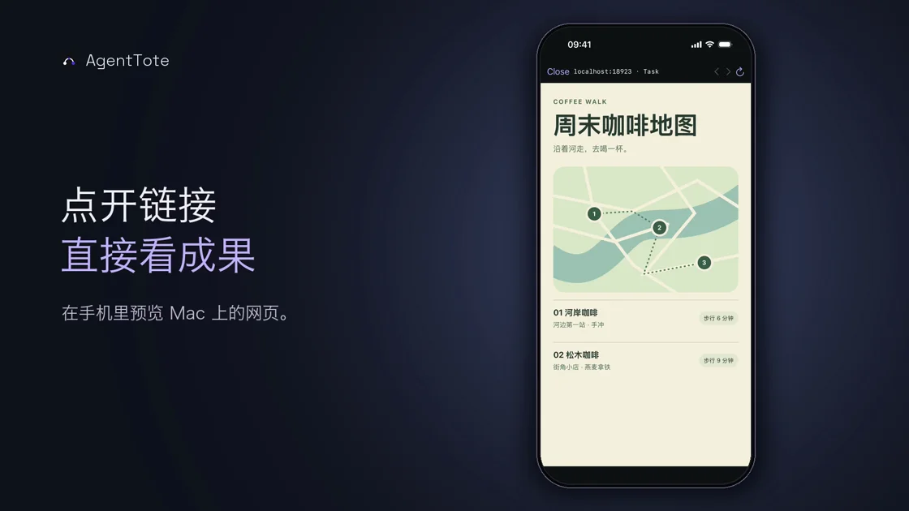
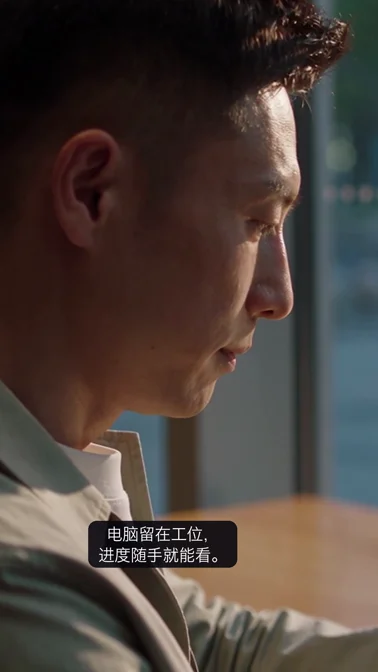
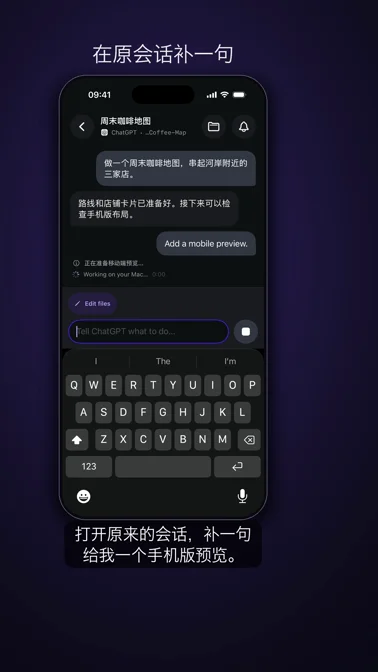

# 真人感产品宣传片 · Codex Skill

用 **火山引擎方舟 Seedance** 云端渲染真人感镜头，再结合真实产品录屏，剪出官网横版和短视频竖版。技能名为 `$make-product-trailer`，可用于不同产品。

## 成片效果

以下是 AgentTote 36 秒宣传片的实际抽帧。人物场景由 Seedance 生成，手机操作在 iOS 模拟器中录制，使用演示数据。

| 官网横版 · 人物开场 | 官网横版 · 产品成果 |
| --- | --- |
|  |  |

| 短视频竖版 · 人物近景 | 短视频竖版 · 放大操作与硬字幕 |
| --- | --- |
|  |  |

## 火山引擎负责哪一段

**从零制作拟真人镜头需要能调用 Seedance 视频生成的火山方舟账号。** AgentTote 示例用已开通的方舟平台能力按量渲染了两段 5 秒、720p 的人物素材，并用豆包 TTS 2.0 生成中文旁白。产品操作单独录制，剪辑、字幕和最终 1080p MP4 在本地合成。已有授权实拍或生成好的素材时，可直接进入合成。

### 检查账号和可用资源

安装并登录 ArkCLI 后运行以下命令。模型或接入点须由当前账号和 Profile 授权调用。列表为空时，先确认当前套餐是否包含视频生成，或平台账号是否已开通 Seedance。生成会消耗套餐额度或产生按量费用，取决于实际调用路径。 [ArkCLI 安装与登录](https://docs.volcengine.com/docs/ark/ark-cli?lang=zh) · [方舟模型计费](https://docs.volcengine.com/docs/ark/model-pricing?lang=zh)

```bash
arkcli auth status
arkcli resources list --modality video
```

### 提交一镜并取回结果

先把 `ark_video_resource` 替换为当前 Profile 实际可用的模型名或接入点 ID。示例只提交一段 5 秒试镜，输出到 `media/lifestyle/`。

```bash
ark_video_resource='替换为可调用的模型名或接入点 ID'
arkcli +gen --modality video --model "$ark_video_resource" \
  --ratio 16:9 --duration 5 --resolution 720p --generate-audio=false \
  --no-open --save-to media/lifestyle \
  '傍晚共享工作室，开发者拿起桌边手机准备出门，笔记本保持打开。单镜头，侧面中近景，自然窗光，屏幕背向镜头。'
```

提交后复制返回的任务 ID。出片前可以查询同一个任务，生成完成时下载。通过方舟平台直接使用已开通的模型 ID 时，可按 [视频生成 API 文档](https://docs.volcengine.com/docs/ark/create-video-generation-task-api?lang=zh) 接入。

```bash
ark_video_task_id='替换为上一步返回的任务 ID'
arkcli gen get "$ark_video_task_id" --wait --no-open --save-to media/lifestyle
```

## 安装和调用

用有仓库访问权限的 GitHub 账号，将技能克隆到 Codex 技能目录。

```bash
skill_root="${CODEX_HOME:-$HOME/.codex}/skills"
mkdir -p "$skill_root"
gh repo clone DeanHilarious/make-product-trailer "$skill_root/make-product-trailer"
```

在目标产品的工作区打开 Codex，提供产品资料、可运行版本或录屏，然后描述想让观众看懂的操作。

> 用 `$make-product-trailer` 给这个产品做一支 30 秒宣传片。用火山方舟 Seedance 渲染人物镜头，录下当前产品的一次关键操作和结果。交付官网横版和抖音竖版，竖版烧录中文字幕。

## 已有素材时直接合成

复制[时间线模板](assets/timeline.example.json)，填写镜头、时长、音轨和字幕。所有素材路径均相对于时间线 JSON。横版可用 `caption_mode: "track"`，竖版可用 `caption_mode: "burn"`。从仓库根目录运行以下命令，需要 Python 3 和 FFmpeg。烧录字幕还需要 FFmpeg 的 `subtitles` 滤镜及字幕所需字体。

```bash
python3 scripts/compose.py /path/to/timeline.json trailer.mp4
```

[技能入口](SKILL.md) · [制作与验收参考](references/production.md) · [合成脚本](scripts/compose.py)
